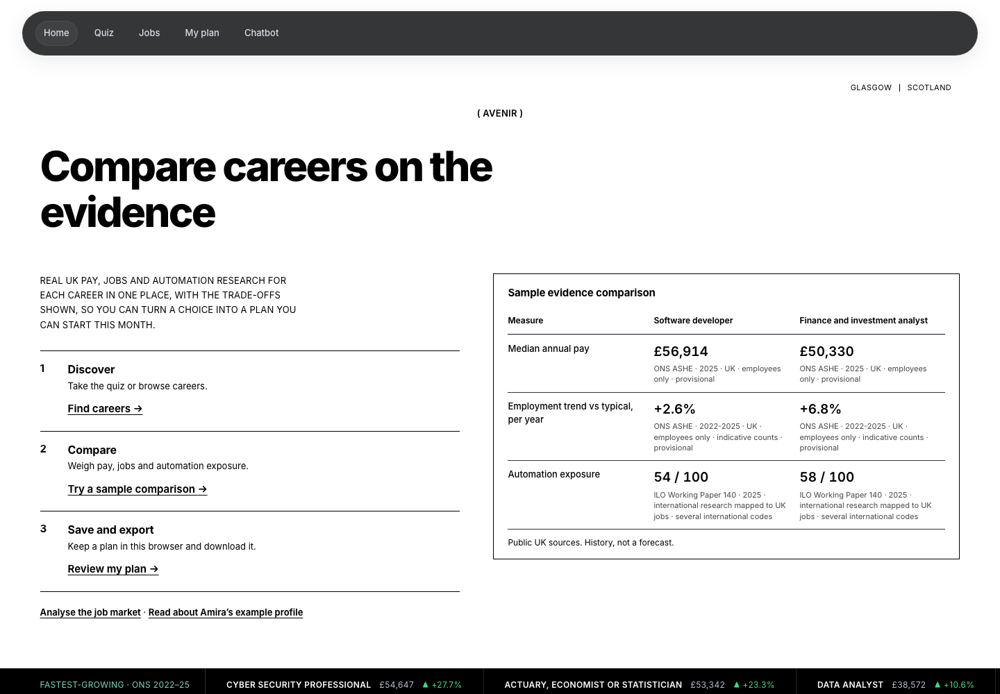

# Avenir

[](https://github.com/yehorm14/avenir/actions/workflows/check.yml)


A career decision tool for UK school leavers: it compares Computer Science and Finance careers using real UK pay, employment and automation data, then builds a plan.



## Why it is useful

- Every pay and job figure shows its ONS source, year and caveats.
- Automation exposure sits next to pay and job trend, labelled as research, not a job-loss forecast.
- The outcome is a saved plan with a route and next actions, not a score.

## Features

- Evidence dashboards for Computer Science and Finance: pay history, jobs, 2022-2025 trend, automation exposure, starting-pay guides.
- Compare tab that weighs pay against employment trend and suggests a first role.
- My plan: route, reasons and actions saved in the browser, downloadable as HTML.
- Jobs directory of 412 occupation profiles and a quiz matching interests to 20 roles.
- Career chatbot answering from the app's data, with sources.
- Historical backtest of simple rules, including failed checks.
- Pull-the-plug harness that disables live sources to show the snapshot fallback.

## How it works

One FastAPI process serves the React app and the APIs, all using an `{ok, data, error, meta}` envelope with source status.
Decision rules are plain functions in `packages/decision`; no LLM ranks careers.
The app serves committed ONS, ILO and ESCO snapshots. Adzuna and LLM adapters (`packages/adapters`) have timeouts and snapshot or template fallbacks.
The chatbot uses an LLM only if a key is configured, and checks its numbers against the sources.

## Tech stack

- Backend: Python 3.12+, FastAPI, Pydantic
- Frontend: React, TypeScript, Vite
- Data: JSON snapshots (ONS ASHE, CPIH, ILO WP140, ESCO), CSV curation
- Tooling: pytest, Ruff, Prettier, Node test runner, GitHub Actions, Docker

## Run locally

```sh
bash scripts/setup.sh
node scripts/run-app.mjs --production   # http://127.0.0.1:4175
```

Needs Python 3.12+ and Node 20+. No keys required; optional settings are in `.env.example`. Docker and Render: [docs/DEPLOY.md](docs/DEPLOY.md).

## Tests

686 Python tests (3 more skipped) and 55 Node tests: `make check` (also runs lint, build and a secret scan; CI runs the same).

## Team and my role

Avenir was built at GUTS 2026 (Glasgow, October 2026) by a team of five for the BlackRock challenge. This repository is my maintained copy of the project.

| Teammate | Main areas (by commit history) |
| --- | --- |
| [Illia (iluha2vuha)](https://github.com/iluha2vuha) | React frontend (`apps/web`) |
| [Yehor Mykhailov (yehorm14)](https://github.com/yehorm14) | API contract, ETL and data pipeline, live adapters, integration |
| [Nazar (Nazar818)](https://github.com/Nazar818) | FastAPI service (`services/api`) and decision rules (`packages/decision`) |
| [Arsenii Harbar (z1nare)](https://github.com/z1nare) | ML evidence pipeline (`packages/ml`, `snapshots/ml`) and frontend work |
| [Max (maksymkhomitskyi)](https://github.com/maksymkhomitskyi) | Pathfinder game prototype (`prototypes/pathfinder-game`) |

My part:

- Owned the API contract (`packages/contracts`): the versioned `{ok, data, error, meta}` schemas, vocabulary and mocks that let the frontend, backend and ML work in parallel.
- Built the ETL and data pipeline (`packages/etl`, `scripts/fetch`, `data/manifest.yaml`) that turns ONS, ILO and ESCO sources into the committed snapshots.
- Built the live adapters (`packages/adapters`): Adzuna with snapshot fallback, and LLM explanations with template fallback.
- Wrote the pull-the-plug demo harness (`scripts/demo`) and the frontend handoff docs (`docs/frontend`).
- Did most of the integration and merging across the four other workstreams.

Since the hackathon I have tidied the repo, fixed cold-install issues, and added tests and CI.

## Credits

Data: ONS ASHE and CPIH (Open Government Licence); Skills England / DfE (OGL); ESCO (European Commission); HESA / Discover Uni (CC BY 4.0); ILO Working Paper 140, Gmyrek et al., 2025 (CC BY 4.0). Ads: Jobs by Adzuna. Details: [docs/data-sources.md](docs/data-sources.md).

> This is an adaptation of a copyrighted work of the International Labour Organization (ILO). This adaptation has not been prepared, reviewed or endorsed by the ILO and should not be considered an official ILO adaptation. The ILO disclaims all responsibility for its content and accuracy.
