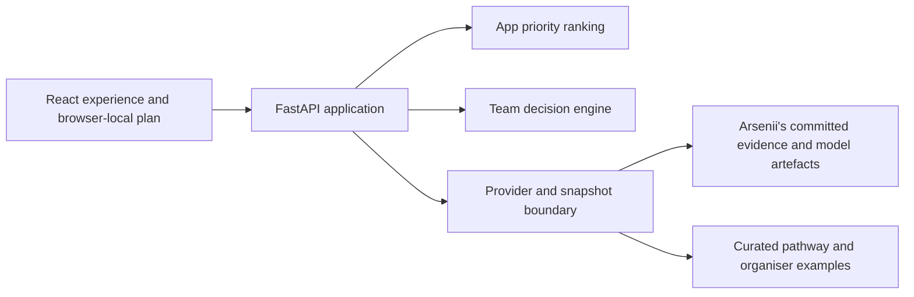

# Aventier

A career decision and action plan for UK school leavers. Compare Computer Science and Finance occupations, set your pay and employment priorities, then choose a first role to explore and a practical next step.

The hackathon demo follows Amira, 17, in Glasgow. She enjoys maths and is choosing between Computer Science and Finance. Occupation earnings, employment evidence and independent automation research help her compare the trade-offs. She decides which role to explore first; Aventier keeps her chosen route and what to try this month.

## Run the complete product

Requires Node 20+ and Python 3.12+. Use a Python executable for that version or newer (`python3.13` in the tested local environment):

On macOS or Linux, prepare the complete app with `bash scripts/setup.sh`. It creates the local environment when absent, installs locked web dependencies and Python development dependencies, builds the app, then checks that both API layers and real evidence load. Recheck an existing setup with `bash scripts/check-setup.sh`.

Set `AVENIR_SETUP_PYTHON` to choose the Python executable used to create `.venv`. The separate `AVENIR_PYTHON` launcher override is for an already-prepared runtime environment.

Manual setup:

```sh
python3.13 -m venv .venv
.venv/bin/python -m pip install -e ".[dev]"
npm --prefix apps/web ci
npm --prefix apps/web run build
node scripts/run-app.mjs --production
```

Open [Aventier](http://127.0.0.1:4175). The production launcher serves the UI and both API layers from one process. No API keys, database, cloud account or external font service are required. Set `AVENIR_PYTHON` to use another Python environment; `AVENIR_PORT` changes the production port. Ctrl+C stops the service.

On Windows, create the environment with `py -3.13 -m venv .venv`, install with `.venv\Scripts\python.exe -m pip install -e ".[dev]"`, then use the same npm and Node commands.

For development, use `node scripts/run-app.mjs`: Vite runs on 4175 and proxies the combined API on 8015. `--preview` is an alias for the single-process production launcher after building.

The complete container definition is `docker compose up --build` (port 4175). It builds the web bundle, includes the committed snapshots and runs without keys as a non-root user. Container execution could not be verified on the current development machine because Docker is not installed. The optional standalone team API is available through `docker compose --profile api-only up api` on port 8000.

## What works

- Direct Computer Science and Finance dashboards cover seven supported occupation groups. Evidence shows source dates, pay history, employment, automation research, starting-pay guides and practical examples. Starting pay remains separate from the workforce median.
- The subject's **Compare** tab weighs pay against historical employment trend, explains the resulting first role to explore and opens **Build my plan**. Results stay within that subject. No interest profile is inferred from opening a subject, and a comparison score is not a prediction of personal success.
- My plan remembers the route, personal reasoning, completed next actions and saved opportunities. Home offers resume. Download produces a readable HTML plan with source links; open it in a browser to print or save as PDF.
- University and earn-and-learn exploration, practical projects, transferable skills and curated organiser links. These are examples and discovery resources; availability and eligibility must be checked at the provider.
- The broader quiz remains available as a secondary journey: editable answers, three weighted options and three learner-ranked choices across **20** roles with supplied interest affinities. Jobs browses **412** occupation profiles; that catalogue is evidence coverage, not 412 calibrated recommendations or complete training plans.
- Deterministic comparisons, evidence confidence and supported skill-overlap alternatives. Historical checks show how simple rules held up, including weak outcomes and failed crisis checks.
- Pay and employment histories, tax-year inflation adjustment, the 2021 occupation-code break and explicit gaps where old occupation mappings are unreliable.
- Prepared career guidance with per-response sources, retry, request cancellation and optional browser read-aloud. Keyboard controls, mobile layouts, reduced motion and text alternatives accompany the charts.

## Architecture and API



`apps/web/api/application.py` assembles the experience API, the canonical `/api/v1` API and the built UI. All served API responses use `{ok, data, error, meta}` with source statuses and request IDs. Explore [OpenAPI](http://127.0.0.1:4175/openapi.json) or [interactive API docs](http://127.0.0.1:4175/docs). The existing shared contract remains in [docs/contracts.md](docs/contracts.md); the assembled schema additionally describes `/api/bootstrap`, `/api/catalogue`, `/api/careers/{soc}`, `/api/discovery`, `/api/matches`, `/api/path/{soc}` and `/api/guide`.

Pure decision functions are in `packages/decision`. Provider interfaces and adapters remain separate in `packages/contracts`, `packages/adapters` and `packages/etl`. The product data boundary excludes synthetic catalogue metrics and unreviewed route rows from canonical ranking; genuine ML metrics are preserved. Unavailable catalogue inputs reduce coverage and confidence. No LLM ranks careers.

## Evidence and AI limits

The committed ML release is **v1.2**. ONS ASHE earnings and employment, ONS CPIH, ILO Working Paper 140, ESCO relationships and supplied UK demand context provide different perspectives. Every observation keeps its source, date, geography, confidence and caveats. Median full-time employee pay excludes the self-employed and is not starting pay; the separate National Careers Service guide describes an example role. Real pay is shown in **2024/25 money**, using tax-year average CPIH. Recent employment trend covers **2022–2025 relative to the typical occupation**: a positive relative value can coexist with falling absolute employment. It is historical evidence, not a vacancy forecast. Missing, suppressed and unreliable mapped history stays missing; low-purity historical mappings create gaps rather than misleading continuity. Task exposure is not a job-loss probability.

Interest affinities and occupation mappings are preliminary. Matcher development labels are synthetic; no validated matching accuracy or admissions eligibility is claimed. The corrected historical backtest assigns simple tiers using base-year evidence before checking later outcomes. Its windows overlap, and windows crossing the 2021 coding change compare pay only. It does not validate the personalised conversation or the subject comparison slider. The 2008 and cost-of-living crisis measures failed placebo checks; their raw observations are disclosed, but they are excluded from recommendation inputs and are not presented as validated resilience signals. Curated routes are examples; the human-verified catalogue CSV is incomplete and has not been passed off as verified.

Codex helped integrate code, write editorial guidance, review changes and run verification. The runtime guide uses prepared source-based responses. Production explicitly uses template explanations, keyword suggestions and snapshot ads, so it remains functional without a live AI provider. The learner chooses priorities, career ranking, route and next actions. These choices are stored in the browser; there is no account, tracking or cross-device sync.

Source attribution: ONS (Open Government Licence); Skills England / DfE (OGL); ILO Working Paper 140 (Gmyrek et al., 2025); ESCO (European Commission); HESA / Discover Uni (CC BY 4.0), where used. The [source registry](snapshots/ml/sources.json) and [data manifest](data/manifest.yaml) retain coverage and licence notes. Optional Adzuna integrations retain Jobs by Adzuna attribution.

## Verify and demonstrate

```sh
PATH="$PWD/.venv/bin:$PATH" make check
```

The release gate covers Python lint, core/API/integration tests, web state/export tests, formatting, production build and a local secret scan. Browser evidence and actual limits are recorded in [apps/web/VERIFICATION.md](apps/web/VERIFICATION.md).

The [launch handoff](docs/launch/README.md) maps the product to the GUTS brief's six core requirements and 17 submission items, with repository evidence and verification steps. Use the [three-minute demo](docs/launch/demo-script.md), [CS/Finance rehearsal notes](docs/launch/cs-finance-demo.md) and [pilot/business case](docs/launch/business-case.md). Pricing, school adoption and pilot targets are hypotheses, not traction or validated demand. The final integrated build's check results belong in the verification record; earlier recorded test counts are historical.

## Team integration

This branch combines Illia's finished frontend, Max's preserved Pathfinder prototype, Nazar's decision engine/API, Yehor's contracts/adapters and Arsenii's real occupation artefacts. Original commits retain their authorship. Earlier explorers remain under `apps/aventir` and `prototypes/pathfinder-game`; `apps/web` is the shipped experience. Read [AGENTS.md](AGENTS.md) before changing another slice.
