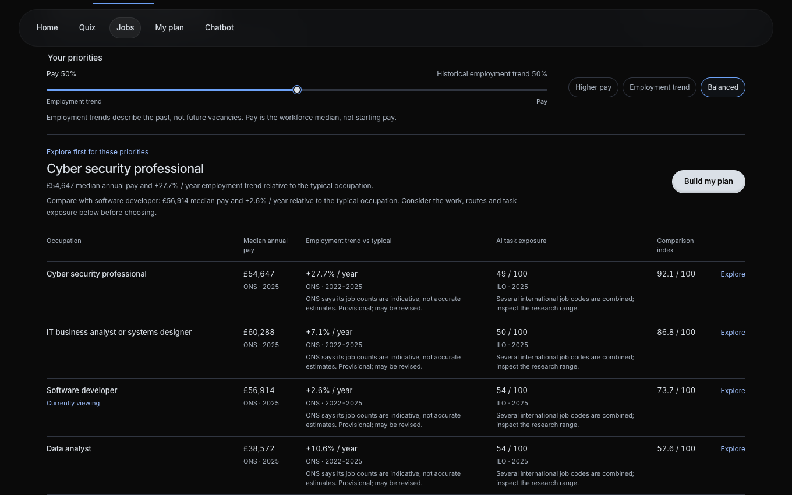
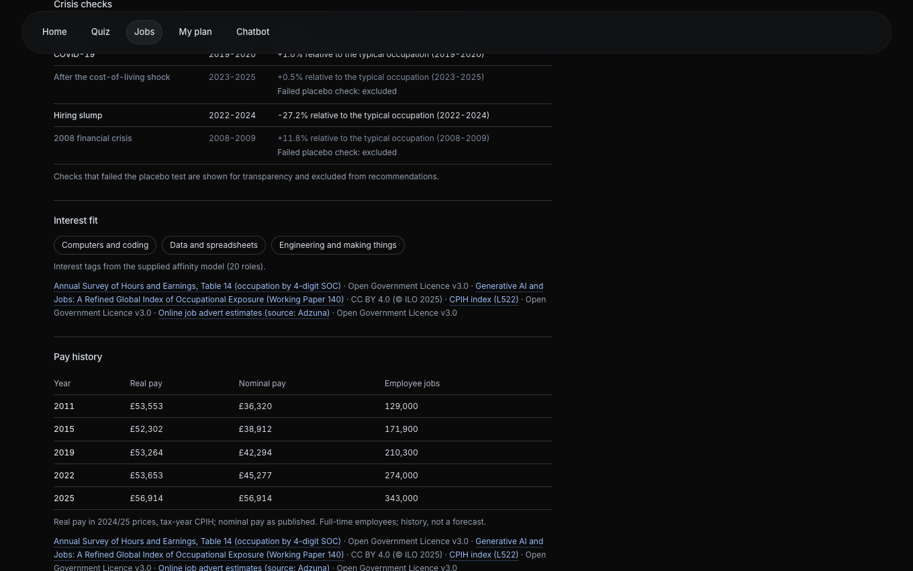
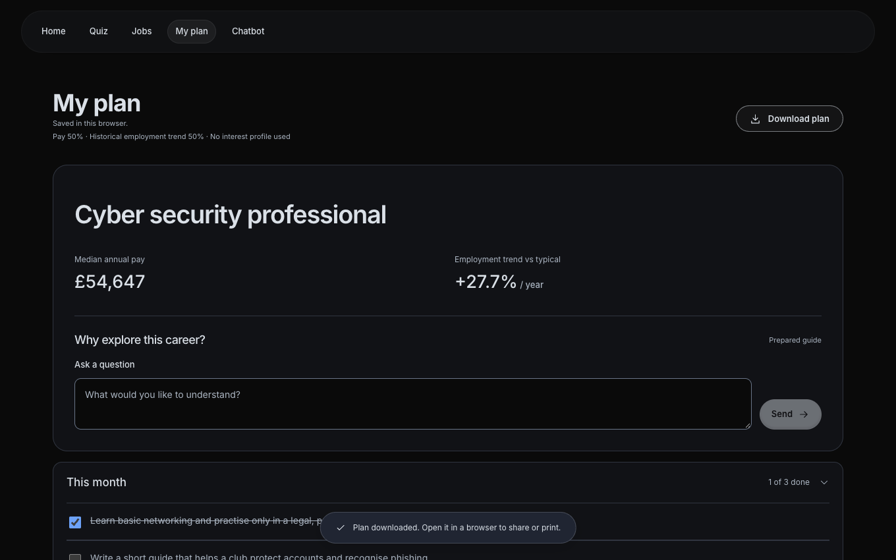
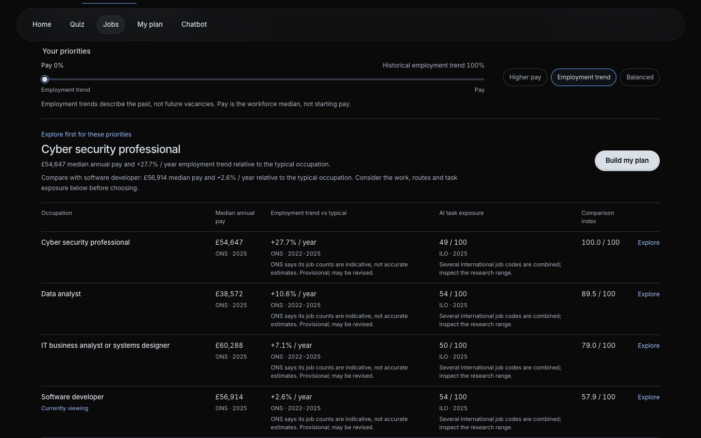

# Avenir walkthrough

[Download the screen recording](https://raw.githubusercontent.com/yehorm14/Avenir/main/docs/demo/avenir-walkthrough.webm), or follow the screenshots below. The recording uses the production Docker image with external networking disabled and no provider keys.

## Compare careers

From **Home**, select **Try a sample comparison**, then **Compare careers**. Compare Software developer and IT business analyst or systems designer using median pay, historical employment trends and AI task exposure. The table shows the source and year next to each figure.

## Check where the numbers come from

Select **Explore** for Software developer and open **Sources and coverage**. The pay history shows the source link to ONS ASHE Table 14 and flags the provisional 2025 estimate.

## Build and save a plan

Return to **Compare careers**, select **Build my plan**, then open **My plan**. The selected career and checklist progress survive a reload in the same browser. **Download plan** exports a readable HTML copy.

## Recalculate with live sources unavailable

Return to **Compare careers** and choose **Employment trend**. The app recalculates the comparison using its bundled evidence. In this recording the container could reach only itself throughout the walkthrough, so the browser still had access to the app and the app had no access to external providers.

To reset, open **My plan → About your saved plan → Clear saved plan** and confirm. To start from prepared quiz answers instead, select **Use Amira’s example profile** on Home. It opens her career matches with a plan you can review.
