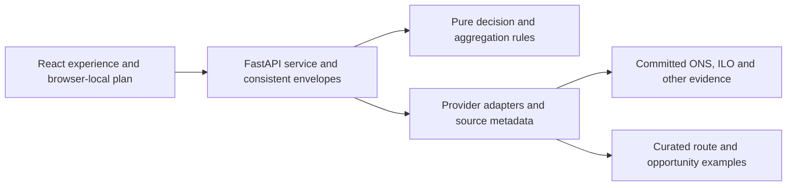

# Aventier launch handoff

**Amira is 17, in S6 in Glasgow, good at maths and art, with a first idea of architect and a worry about AI. Her decision is which career to aim for and what her next step is.** The primary journey is [Amira and architect](demo-script.md); Computer Science vs Finance is a [secondary journey](cs-finance-demo.md).

The GUTS brief asks for **ONE APP. ONE CLEAR DECISION.** Aventier combines occupation earnings and employment with independent automation research, explains the trade-offs, and turns Amira's chosen priorities into a first role to explore. She then chooses a route and keeps a practical plan. The primary demo is Home → Try architect → three picks vs her first idea and a hedge → backtest → roadmap. The secondary CS/Finance path is Home → subject Evidence → Compare → Build my plan.

- [Three-minute demo script (Amira and architect)](demo-script.md) and [secondary CS/Finance rehearsal notes](cs-finance-demo.md)
- [Pilot and business hypotheses](business-case.md)
- [Application setup](../../apps/web/README.md), [API contract](../contracts.md), [ML v1.2 contract](../../packages/ml/CONTRACTS.md), [source registry](../../snapshots/ml/sources.json)

## Scope and claim boundaries

| Demo capability                                                                       | Boundary to explain                                                                                                                                                                          |
| ------------------------------------------------------------------------------------- | -------------------------------------------------------------------------------------------------------------------------------------------------------------------------------------------- |
| Computer Science and Finance evidence and comparison across seven occupation groups   | Results stay within the selected subject. Some occupation groups combine several job titles; a group's statistics do not describe every graduate or every job within it.                     |
| Pay / Employment trend priority slider, an explained recommendation and Build my plan | The comparison uses explicit deterministic weights. No interest profile is inferred. Scores compare supplied evidence; they are not personal earnings forecasts or probabilities of success. |
| My plan, route choice, notes, next actions, saved opportunities and export            | State is saved in this browser. There is no account, cross-device sync or adviser dashboard. Course and opportunity links are examples, not confirmed eligibility, vacancies or bookings.    |
| ONS pay and employment, ILO exposure, NCS starting-pay guides and historical checks   | Workforce median pay is separate from starting pay. Exposure is not job-loss risk. Historical checks do not validate an individual's recommendation.                                         |
| Broader quiz and Jobs directory                                                       | These are secondary journeys. Interest matching covers 20 roles; the 412-profile catalogue is evidence coverage, not 412 calibrated matches or complete training plans.                      |
| Prepared career guide with source links, retry and optional read-aloud                | The core demo needs no live language model or API key. External source websites still need internet. Replies and source coverage must be inspected rather than assumed complete.             |

## Evidence definitions in this release

The application uses the owner's committed **ML v1.2** artefacts. Real pay uses tax-year average CPIH and is expressed in **2024/25 money**. Recent employment trend covers **2022–2025 relative to the typical occupation**; positive relative performance does not prove absolute job growth. ONS counts are indicative, not current vacancies. Source periods, geographic coverage, research ranges and missing values remain visible.

History respects missing years and the 2021 occupation-code break. Low-purity mappings are unsuitable for a continuous historical line and are shown as gaps. The historical panel explains how simple base-year rules held up in later outcomes; overlapping windows and pay-only comparisons across the coding break limit interpretation. It is not a backtest of Amira's interests, the current comparison slider or personal career success.

The 2008 and cost-of-living crisis measures failed their placebo checks. Raw observations remain available for disclosure, while these measures are excluded from recommendation inputs and are not treated as validated resilience signals. COVID and tech-slump observations retain their own coverage and caveats. Read the [ML method and review fixes](../../packages/ml/README.md) before making stronger claims.

## Architecture and trade-offs



The [UI](../../apps/web/src/) presents the decision, the [decision package](../../packages/decision/) and [app ranking](../../apps/web/api/ranking.py) apply explicit rules, and [provider adapters](../../packages/adapters/) isolate data integration. Decision functions perform no network calls and do not ask a language model to rank careers. The [assembled application](../../apps/web/api/application.py) serves the UI and both API layers.

Committed snapshots make the demo reproducible without keys or external providers; they do not promise live coverage. A narrow subject comparison makes the first decision understandable; the broader catalogue stays available for further exploration. Browser-local state avoids an account requirement but cannot sync across devices. Prepared guidance is predictable without a live model, but users must check source details and current entry requirements. School adoption, pricing and pilot targets remain [hypotheses](business-case.md).

## Run and verify

The [portable submission guide](submission.md) explains the prebuilt ZIP, its revision/checksums and Python-only startup. The developer checkout uses the workflow below.

From the repository root, with **Node 20+ and Python 3.12+**:

```sh
bash scripts/setup.sh
node scripts/run-app.mjs --production
```

Open [the local app](http://127.0.0.1:4175). Setup creates `.venv` when absent, installs locked web dependencies and Python development dependencies, builds the frontend and checks both API layers with committed real evidence. No API key, database or cloud account is required. `AVENIR_SETUP_PYTHON` selects the Python executable for setup; `AVENIR_PYTHON` selects an already-prepared runtime. `AVENIR_PORT` changes the production port. Windows manual commands are in the [root README](../../README.md#run-the-complete-product).

```sh
bash scripts/check-setup.sh
PATH="$PWD/.venv/bin:$PATH" make check
.venv/bin/python scripts/demo/pull_the_plug.py --base-url http://127.0.0.1:4175 --freeze
```

Run the final command with the local app already running. It checks provider status and fallback honesty; missing adverts are labelled missing and produce a warning. External-internet resilience means local browser/API communication remains available. Global DevTools Offline mode can block that local API too and is useful for the error/retry test, not proof that committed evidence is unavailable.

The production launcher serves one origin on port 4175; `--preview` is an alias. Development uses `node scripts/run-app.mjs`, with Vite on 4175 and the API on 8015. [Docker Compose](../../docker-compose.yml) defines the complete app with `docker compose up --build`; execution is unverified on the current machine because Docker is unavailable.

The release owner must run these checks against the final integrated commit and record actual output, skips and browser evidence in [VERIFICATION.md](../../apps/web/VERIFICATION.md). Earlier pass counts in that record describe their named earlier commits. This handoff makes no new test-count or rubric-score claim. The tracked-file secret scan is not a certification of all Git history.

## Six core requirements

The labels below follow the supplied GUTS brief. The evidence column shows where each requirement can be assessed; the release checks are actions to perform, not unchecked claims of a final pass.

| #   | Brief requirement        | Repository evidence and release check                                                                                                                                                                                                                                                                                                                                             |
| --- | ------------------------ | --------------------------------------------------------------------------------------------------------------------------------------------------------------------------------------------------------------------------------------------------------------------------------------------------------------------------------------------------------------------------------- |
| 1   | Multiple data sources    | [Registry](../../snapshots/ml/sources.json): inspect ONS earnings/employment and independent ILO task-exposure research, then the separate NCS starting-pay source. Static datasets served through the API are explicitly allowed by the brief. Preserve source dates, geography and limitations.                                                                                 |
| 2   | API-first design         | [Contract](../contracts.md), [canonical API](../../services/api/), [app API](../../apps/web/api/): inspect requests/responses and the served [OpenAPI](http://127.0.0.1:4175/openapi.json); exercise success, validation, unknown-code and missing-provider responses in the common envelope.                                                                                     |
| 3   | Three separated layers   | [UI](../../apps/web/src/), [decision rules](../../packages/decision/), [adapters](../../packages/adapters/): trace one comparison from user weights through pure scoring to provider evidence.                                                                                                                                                                                    |
| 4   | Engineering standards    | [Makefile](../../Makefile), [core tests](../../packages/decision/tests/), [integration tests](../../apps/web/api/tests/), [setup](../../scripts/setup.sh), [secret scan](../../scripts/check_secrets.py): run the complete gate, validate failures/retry, review meaningful commits, and reproduce setup. Architecture and trade-offs are above.                                  |
| 5   | Cohesive user experience | Follow Amira's primary journey through Evidence, Compare, an explained first role, route and saved action. Check keyboard focus, chart/table alternatives, reduced motion, 1200×800 and 1440×1000 desktop layouts.                                                                                                                                                                |
| 6   | Responsible use of AI    | [ML method](../../packages/ml/README.md), [explanation checks](../../packages/ml/pathfinder_ml/explain.py), [guide](../../apps/web/src/Guides.tsx): disclose preliminary offline affinities, synthetic development labels, prepared replies and human choices. Demonstrate no-key operation, validation and fallback. No live LLM is required or presented as the ranking engine. |

## Seventeen submission items

| #   | Brief checklist item                                                 | Concrete evidence / demonstration                                                                                                                                                                                                                                                                               |
| --- | -------------------------------------------------------------------- | --------------------------------------------------------------------------------------------------------------------------------------------------------------------------------------------------------------------------------------------------------------------------------------------------------------- |
| 1   | One named user and one clear decision                                | Amira, 17, choosing the first CS/Finance role to explore and a practical next action. Use the [demo script](demo-script.md).                                                                                                                                                                                    |
| 2   | At least two independent sources                                     | Open an ONS observation and ILO research source in Evidence; show distinct dates, scopes and caveats from the [registry](../../snapshots/ml/sources.json).                                                                                                                                                      |
| 3   | Normalisation, comparison or interpretation                          | Move the Pay / Employment trend priority slider in Compare; inspect the explanation and weighted comparison. Real pay uses tax-year CPIH; missing inputs remain explicit.                                                                                                                                       |
| 4   | End-to-end path demonstrated                                         | Home → subject → Evidence → Compare → Build my plan → route, note and next action → export → refresh/resume.                                                                                                                                                                                                    |
| 5   | OpenAPI/Swagger or equivalent contract, or API design                | Inspect the [contract](../contracts.md), served [OpenAPI](http://127.0.0.1:4175/openapi.json) and [interactive docs](http://127.0.0.1:4175/docs).                                                                                                                                                               |
| 6   | Separation between experience, decision logic and integration layers | Use the architecture diagram and inspect [UI](../../apps/web/src/), [pure decisions](../../packages/decision/) and [provider adapters](../../packages/adapters/).                                                                                                                                               |
| 7   | Unit tests for core logic                                            | Run `make check`; inspect [decision tests](../../packages/decision/tests/), [ML tests](../../packages/ml/tests/) and [web state/export tests](../../apps/web/tests/).                                                                                                                                           |
| 8   | At least one integration test                                        | [Production integration tests](../../apps/web/api/tests/): exercise joined UI/API serving, real evidence, validation and metadata through the assembled service.                                                                                                                                                |
| 9   | Graceful failure behaviour                                           | In an isolated browser, fail a local request and demonstrate retry. Show missing observations honestly; repeat the core flow with external providers unavailable.                                                                                                                                               |
| 10  | No secrets committed; inputs validated                               | Run the tracked-file scan via `make check`; exercise invalid input/unknown SOC responses. Optional keys belong in ignored `.env`, never browser code. Do not claim the scan proves all historical commits are secret-free.                                                                                      |
| 11  | Clear README and prerequisites                                       | [Root README](../../README.md): Node 20+, Python 3.12+, startup, scope, architecture and limits.                                                                                                                                                                                                                |
| 12  | Clean setup instructions                                             | Run [setup](../../scripts/setup.sh) and [check-setup](../../scripts/check-setup.sh) from a clean checkout with no optional credentials, then start the production launcher.                                                                                                                                     |
| 13  | Architecture diagram and trade-offs                                  | The diagram and snapshot/scope/local-state/prepared-guide decisions above; [business hypotheses](business-case.md) distinguish a possible pilot from current traction.                                                                                                                                          |
| 14  | Accessible, cohesive interface                                       | Keyboard-test the full primary flow, priority control, visible focus and chart year inspection; inspect text alternatives, reduced motion and desktop screenshots. Record actual browser/Lighthouse results.                                                                                                    |
| 15  | Source and recommendation explanations                               | Show sources, periods, ranges and caveats in Evidence, then the priority-based reason and trade-off in Compare. Workforce pay, starting-pay examples and research exposure stay distinct.                                                                                                                       |
| 16  | AI usage and checks disclosed                                        | Codex assisted coding, editorial work, review and verification. Offline embedding affinities support the secondary interest matcher; development labels are synthetic. The primary comparison is deterministic, and the guide uses prepared information. Show [checks and limits](../../packages/ml/README.md). |
| 17  | Fallback if AI is unavailable or wrong                               | Run with optional keys/providers absent. Prepared guidance and committed evidence remain available; invalid optional generated prose is rejected by [explanation validation](../../packages/ml/pathfinder_ml/explain.py) and falls back to a template. The learner confirms choices.                            |

This is an evidence map to the supplied brief, not a score prediction. Final submission proof is the release owner's recorded integrated checks and the demonstrated learner journey.
